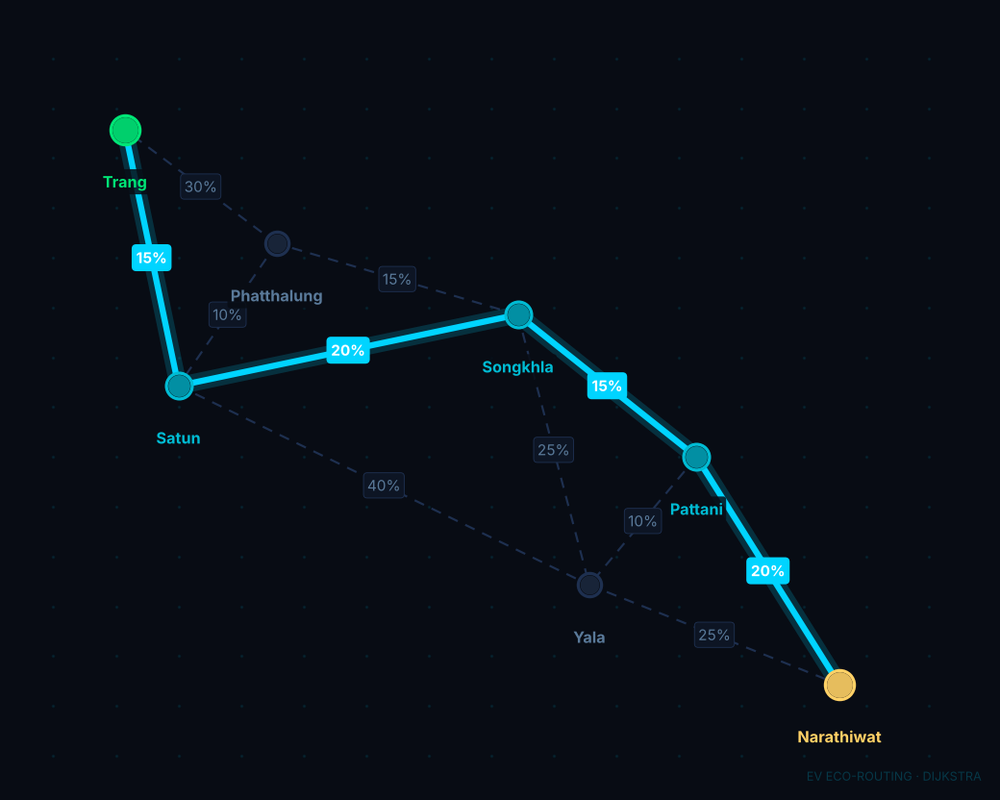

# Python Algorithm Visualizers

**English** | [ภาษาไทย](README.th.md)

Two desktop apps that turn classic algorithms into something you can watch and interact with, written in Python with Tkinter.

| Project | What it does | Key algorithms | Type |
|---|---|---|---|
| [EV Eco-Routing](ev-eco-routing/README.md) | Finds the route that uses the least battery between 7 provinces in southern Thailand and checks whether the current charge is enough | Dijkstra's shortest path with a priority queue (`heapq`) | Individual course project (2026) |
| [Algorithms Visualizer](algorithms-visualizer/README.md) | Animates sorting and searching step by step, with custom or random input, speed control and comparison counts | Bubble, Selection, Insertion, Merge Sort · Sequential and Binary Search | Team mini-project (2025) |



*EV Eco-Routing: the lowest-battery route from Trang to Narathiwat (70%) goes through Satun, Songkhla and Pattani.*

## Quick start

Requires Python 3.10+ with Tkinter (included in the standard Windows and macOS installers).

```bash
git clone https://github.com/nazhan0-dev/python-algorithm-visualizers.git
cd python-algorithm-visualizers
pip install -r requirements.txt

python ev-eco-routing/ev_eco_routing.py
python algorithms-visualizer/algorithms_visualizer.py
```

On Ubuntu/Debian, install Tkinter first with `sudo apt install python3-tk`.

## Repository layout

```
python-algorithm-visualizers/
├── ev-eco-routing/          # Dijkstra route planner (Tkinter + Matplotlib)
├── algorithms-visualizer/   # Sorting & searching animations (Tkinter)
├── docs/                    # Screenshots used in the READMEs
└── requirements.txt
```

## Background

Both projects come from the Data Structures & Algorithms course in the Computer Science program at Songkhla Rajabhat University. The interface text is in Thai; code and documentation are in English.

