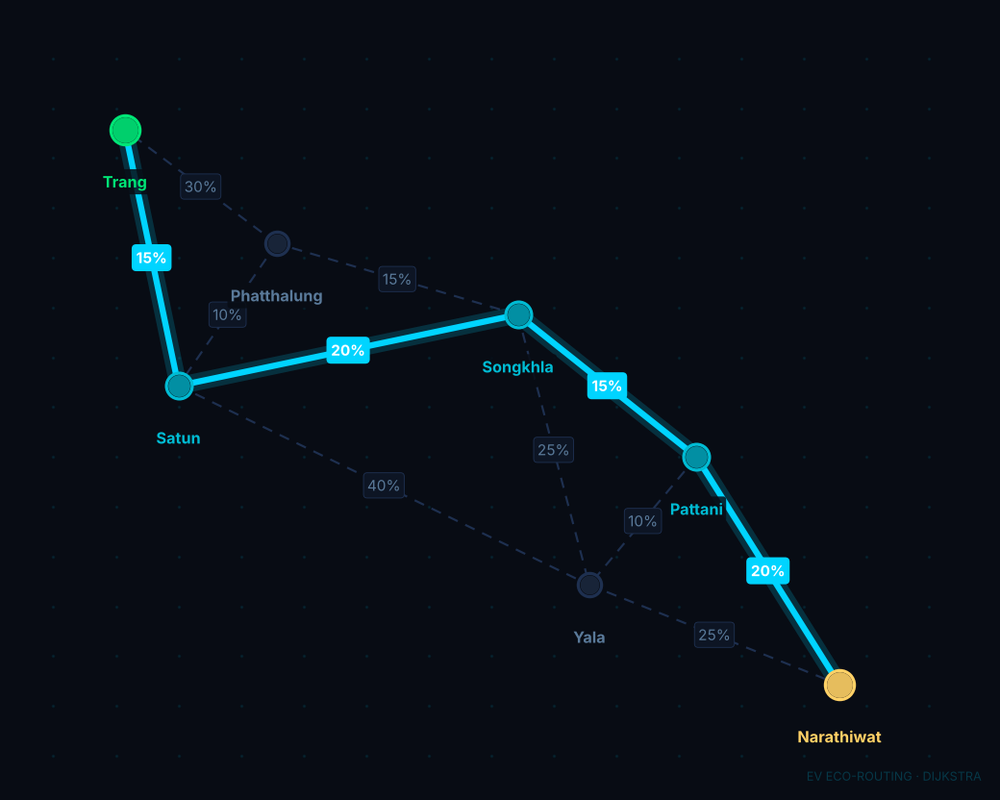

# EV Eco-Routing

[ภาษาไทย](README.md) | **English**

A route planner for electric vehicles in the lower south of Thailand. Pick a start and destination province, set the current battery level, and the app finds the route that uses the least battery with Dijkstra's algorithm, then tells you whether you can make the trip without charging.



## Features

- Lowest-battery route between 7 provinces: Songkhla, Phatthalung, Trang, Satun, Pattani, Yala and Narathiwat
- Battery slider (0–100%) with a colour-coded charge bar
- Feasibility check: shows battery used and remaining, or how much is missing if the charge is too low
- Map drawn with Matplotlib inside the Tkinter window, highlighting the chosen path, direction arrows and the battery cost of every road
- Input validation for a missing selection or identical start and destination

## How it works

The road network is a weighted, undirected graph stored as an adjacency list. Each edge weight is the percentage of battery the drive takes.

```python
GRAPH = {
    "Songkhla": {"Phatthalung": 15, "Satun": 20, "Pattani": 15, "Yala": 25},
    ...
}
```

`dijkstra(start, end)` keeps a min-heap of `(cost, node)` pairs:

1. Pop the node with the lowest known cost; skip it if already visited.
2. Stop early once the destination is popped, since its cost is now final.
3. Relax each neighbour: if `cost + weight` beats its known distance, record it and its predecessor, and push it onto the heap.
4. Rebuild the path by following predecessors back from the destination.

**Complexity:** O((V + E) log V) time and O(V) space, with V provinces and E roads.

Example results:

| From → To | Route | Battery |
|---|---|---|
| Trang → Narathiwat | Trang → Satun → Songkhla → Pattani → Narathiwat | 70% |
| Phatthalung → Narathiwat | Phatthalung → Songkhla → Pattani → Narathiwat | 50% |
| Satun → Pattani | Satun → Songkhla → Pattani | 35% |

The battery costs are illustrative values chosen for the course project, not measured consumption data.

## Run

```bash
pip install -r ../requirements.txt
python ev_eco_routing.py
```

## Tech

Python · Tkinter · Matplotlib (embedded with `FigureCanvasTkAgg`) · NumPy · `heapq`
