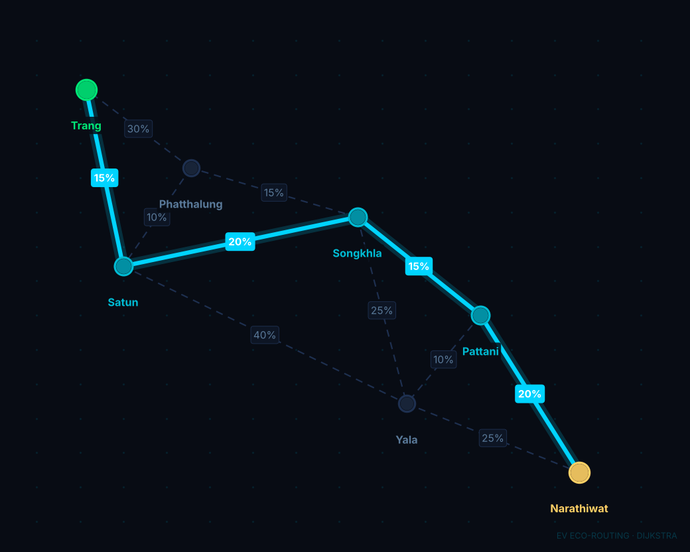

# EV Eco-Routing

**ภาษาไทย** | [English](README.en.md)

ระบบนำทางสำหรับรถยนต์ไฟฟ้าในภาคใต้ตอนล่าง เลือกจังหวัดต้นทางและปลายทาง ตั้งระดับแบตเตอรี่ปัจจุบัน แล้วโปรแกรมจะหาเส้นทางที่ใช้แบตน้อยที่สุดด้วยอัลกอริทึม Dijkstra พร้อมบอกว่าเดินทางได้โดยไม่ต้องชาร์จหรือไม่



## ฟีเจอร์

- หาเส้นทางที่ใช้แบตน้อยที่สุดระหว่าง 7 จังหวัด: สงขลา พัทลุง ตรัง สตูล ปัตตานี ยะลา และนราธิวาส
- แถบเลื่อนตั้งระดับแบตเตอรี่ (0–100%) พร้อมแถบแบตเปลี่ยนสีตามระดับ
- ตรวจความเป็นไปได้: แสดงแบตที่ใช้และที่เหลือ หรือแบตที่ขาดถ้าไม่พอ
- วาดแผนที่ด้วย Matplotlib ในหน้าต่าง Tkinter ไฮไลต์เส้นทางที่เลือก ลูกศรบอกทิศทาง และค่าแบตของแต่ละเส้นทาง
- ตรวจสอบข้อมูลนำเข้า เช่น ยังไม่ได้เลือกจังหวัด หรือเลือกต้นทางกับปลายทางซ้ำกัน

## หลักการทำงาน

เครือข่ายถนนเก็บเป็นกราฟแบบมีน้ำหนักและไม่มีทิศทางในรูป adjacency list โดยน้ำหนักของแต่ละเส้นคือเปอร์เซ็นต์แบตที่ใช้ในการขับ

```python
GRAPH = {
    "Songkhla": {"Phatthalung": 15, "Satun": 20, "Pattani": 15, "Yala": 25},
    ...
}
```

ฟังก์ชัน `dijkstra(start, end)` ใช้ min-heap เก็บคู่ `(cost, node)`:

1. ดึงโหนดที่มีค่าใช้จ่ายต่ำสุดออกมา ถ้าเคยเยี่ยมแล้วให้ข้าม
2. หยุดทันทีเมื่อดึงปลายทางออกมาได้ เพราะค่าของปลายทางเป็นค่าสุดท้ายแล้ว
3. ปรับค่าเพื่อนบ้าน (relax): ถ้า `cost + weight` น้อยกว่าระยะที่รู้อยู่ ให้บันทึกค่าใหม่และโหนดก่อนหน้า แล้วใส่ลง heap
4. สร้างเส้นทางย้อนกลับจากปลายทางตามโหนดก่อนหน้า

**ความซับซ้อน:** เวลา O((V + E) log V) และพื้นที่ O(V) โดย V คือจำนวนจังหวัด และ E คือจำนวนเส้นทาง

ตัวอย่างผลลัพธ์:

| ต้นทาง → ปลายทาง | เส้นทาง | แบตที่ใช้ |
|---|---|---|
| ตรัง → นราธิวาส | ตรัง → สตูล → สงขลา → ปัตตานี → นราธิวาส | 70% |
| พัทลุง → นราธิวาส | พัทลุง → สงขลา → ปัตตานี → นราธิวาส | 50% |
| สตูล → ปัตตานี | สตูล → สงขลา → ปัตตานี | 35% |

ค่าแบตที่ใช้เป็นค่าสมมติสำหรับโปรเจกต์ในรายวิชา ไม่ใช่ข้อมูลการใช้พลังงานจริง

## วิธีรัน

```bash
pip install -r ../requirements.txt
python ev_eco_routing.py
```

## เทคโนโลยี

Python · Tkinter · Matplotlib (ฝังด้วย `FigureCanvasTkAgg`) · NumPy · `heapq`
